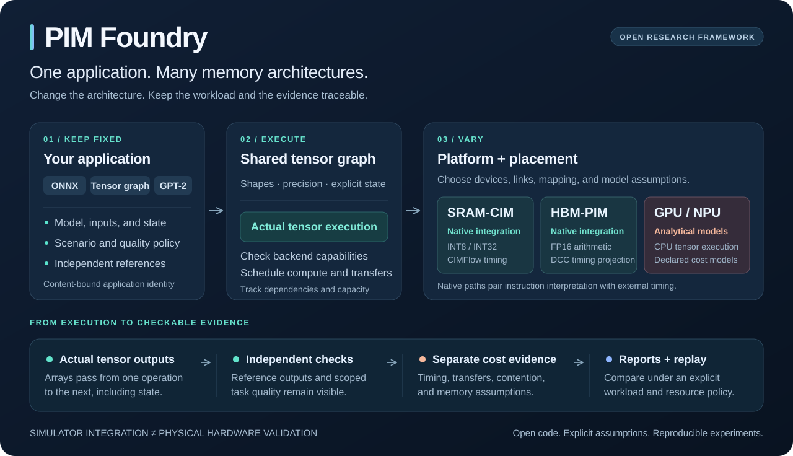
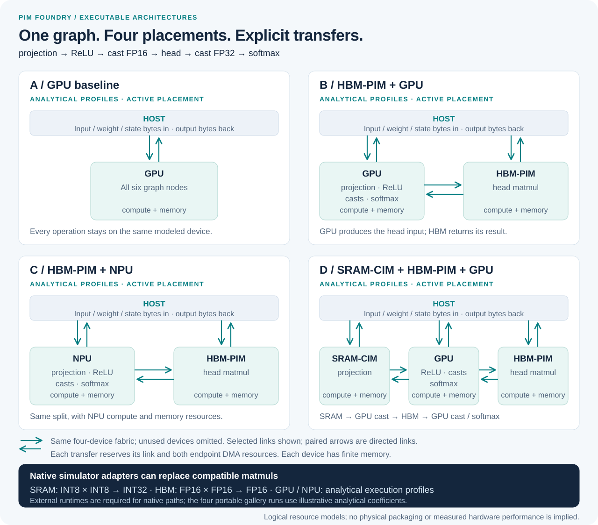
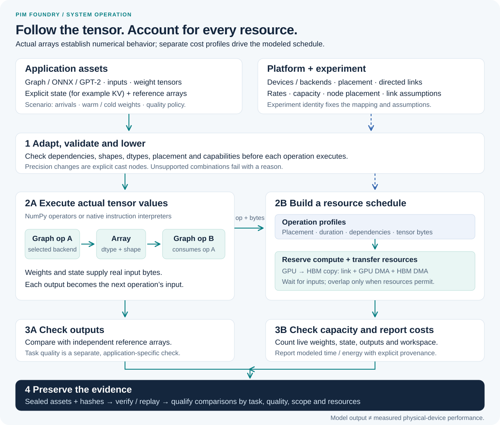
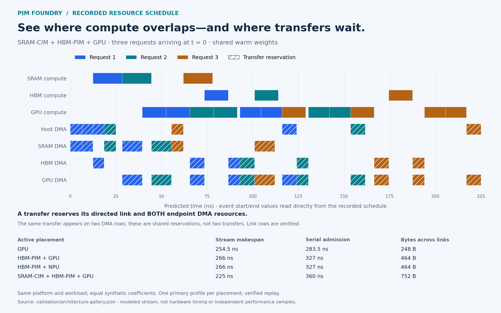
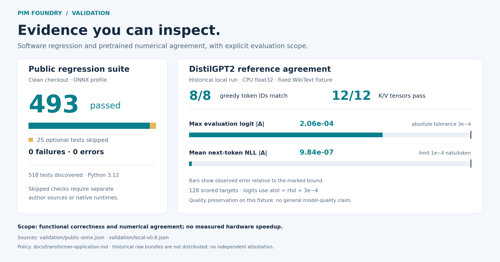
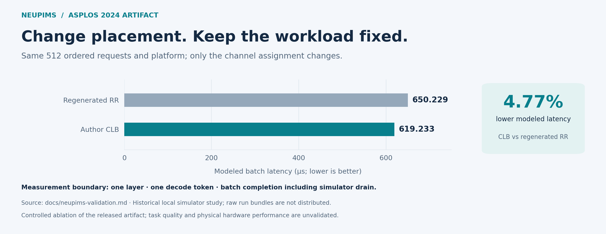

# PIM Foundry

**一個應用，多種記憶體架構，每項結果都能追查與重跑。**

[](https://github.com/Lewis-panda/pim-foundry/actions/workflows/ci.yml)
[](https://github.com/Lewis-panda/pim-foundry/releases/latest)
[](LICENSE)
[](pyproject.toml)

[English](README.md) · [開始使用](#執行第一個實驗) · [論文成果](#論文接入與具體成果) · [完整文件](#繼續探索) · [參與開發](CONTRIBUTING.md)

把某個運算從 SRAM-CIM 移到 HBM-PIM，再加入 GPU／NPU 模型，觀察**實際張量輸出、資料搬移、資源競爭與成本預測**如何改變。PIM Foundry 讓應用、精度政策、參考輸出和比較界線都有明確定義。



- **跨記憶體架構做研究。** 共用張量圖、ONNX 匯入、完整 GPT-2 prefill／decode，以及明確的後端介面。
- **在揭露條件下比較。** 更換節點配置或架構，同時追蹤精度、容量、搬移、請求抵達和計量範圍。
- **追查每一項結果。** 獨立輸出檢查、作者模擬器計數器、綁定內容的輸入，以及凍結執行引擎的重播。

目前為 v0.8 研究預覽版：原生路徑接入另外建置的模擬器；GPU／NPU 成本採分析模型，張量數值在 CPU 上執行。1.0 前介面仍可能調整。[執行範圍與限制](docs/limitations.md)。

## 系統如何運作、可以模擬哪些組合

SRAM 的第一個投影產生 96 bytes 的 INT32 中間值；GPU 讀取後執行 ReLU，明確轉成 48 bytes 的 FP16，再交給 HBM 執行下一個投影。後續運算會讀取真正產生的張量，搬移事件則保存在排程紀錄中。



[架構範例](docs/architecture-gallery.md)已實際執行**四種配置**，核對獨立數值參考、驗證及重播封存包，並記錄 compute、link、DMA 和記憶體峰值。完整平台與工作負載保持相同，使用一致的示意分析係數。

```sh
# 已安裝 tensor 或 ONNX extra 後：
python examples/architecture_gallery.py --out runs/architecture-gallery
```

<details>
<summary><strong>展開系統執行流程與實際產生的排程圖</strong></summary>





[完整操作說明](docs/architecture-gallery.md) · [事件與結果資料](validation/architecture-gallery.json) · [下載並開啟本地互動檢視頁](docs/assets/architecture-explorer.html)

圖中呈現模型執行與預測資源占用；這組可攜範例沒有執行實體加速器或原生模擬器。

</details>

## 看得見依據的成果

**完整預訓練模型，逐步核對 decode。** DistilGPT-2 開發實驗執行六層模型、embedding、attention、MLP、詞彙投影與 KV 更新，對照獨立的 Transformers CPU reference。



軟體測試來自公開 checkout。預訓練模型結果來自歷史本機實驗，品質評估涵蓋固定 WikiText 前綴的 **128 個 next-token targets**；模型與資料需另行取得，歷史原始封存包未隨專案發布。[機器可讀結果](validation/local-v0.8.json) · [重跑與評估範圍](docs/transformer-application.md) · [CI 證據](VALIDATION.md)。

**固定條件的論文模型比較。** NeuPIMs 實驗讓 round-robin（RR）與 channel load balancing（CLB）使用**順序相同的 512 個請求與相同平台**。在單層、單 token、包含模擬器排空的批次中，CLB 的模型延遲低 **4.77%**。



這是歷史本機實驗中的特定配置消融，未評估任務品質或實體硬體效能。不同平台的 NPU-only 執行結果保留在證據中，不納入此同平台比值。[輸入、計數器、負向控制與重跑流程](docs/neupims-validation.md)。

## 論文接入與具體成果

從固定版本的作者程式，探索 **IISWC、DAC、ASPLOS、ISCA** 的研究。下表列出開發期間實際執行或審查的範圍；公開 repository 不附上游資產與歷史原始封存包。狀態對應表中的實驗範圍，不能直接延伸成整篇論文的全部結果。

| 論文 | 已展示的具體結果 | 狀態／範圍 |
|---|---|---|
| **[PIMbench](https://www.cs.virginia.edu/venkat/papers/iiswc2024.pdf)** · IISWC 2024 | Bit-serial、Fulcrum、bank-level PIM 的 **9 個應用／架構案例**，27 次直接／adapter／重播執行；獨立驗證 **7,168 個三角形**。 | **選定應用已執行。** 使用限定幾何；KNN 任務品質未獲確認。[證據／重跑](docs/pimbench-validation.md)。 |
| **[NeuPIMs](https://arxiv.org/abs/2403.00579)** · ASPLOS 2024 | **512 個相同請求**、三種 variant 與三次重播；直接執行與 adapter 的時間計數器一致。上圖呈現受控 CLB／RR 比較。 | **時序一致性＋重播通過。** 單層、單 decode token；未執行張量品質評估。[證據／重跑](docs/neupims-validation.md)。 |
| **[STARC](https://doi.org/10.1145/3779212.3790226)** · ASPLOS 2026 | Full／STARC 執行與重播共 **508 次原生呼叫**；CSV／cache 與獨立直接執行結果**逐 byte 相同**。 | **128-token 視窗內一致。** 安全修補獨立標記；未跑完整長生成 sweep。[證據／重跑](docs/starc-application.md)。 |
| **[CIMFlow](https://arxiv.org/abs/2505.01107)** · DAC 2025 | ResNet-18 DP 的直接／adapter／重播同為 **3.560054 ms**；其他測試配置在 ISA bytes 相同時仍有時間差異。 | **保留重現失敗狀態。** Backbone 時序，沒有完整分類器品質主張。[證據](docs/cimflow-application-validation.md)。 |
| **[DCC](https://arxiv.org/abs/2511.15503)** · ISCA 2026 | 用 AddressSanitizer 重現 controller use-after-free，發布獨立標記的修補與明示命令完成模型。 | **Runtime 審查＋修補版接入。** Completion delay 為明示假設。[審查](docs/dcc-runtime-audit.md) · [修補](patches/dcc/README.md)。 |
| **[IANUS](https://arxiv.org/abs/2410.15008v1)** · ASPLOS 2024 | **8 項算術檢查**符合顯示精度；**4 項分母檢查**在列明假設下出現不一致。 | **僅論文審查。** 未取得可認證的作者執行 artifact。[證據](docs/ianus-validation.md)。 |

**找出原始 reference 也會漏掉的問題。** PIMbench 的 CPU reference 接受了把 BMP metadata 當像素、把 label 納入 KNN 距離的結果。Foundry 的獨立檢查將這些結果與數值一致性分開記錄，並排除不符合品質條件的比較。[查看反例](docs/pimbench-validation.md#independent-failure-evidence)。

來源、失敗分析與應用執行／論文復現／硬體校準的區分，見[研究證據](docs/research-evidence.md)。列出論文名稱表示接入或審查，不表示原作者背書。

## 執行第一個實驗

需要 Python 3.10+ 與 CPU。安裝完成後，範例使用自行產生的輸入，**離線執行**，不必下載模型或建置外部模擬器。

```sh
git clone https://github.com/Lewis-panda/pim-foundry.git
cd pim-foundry
python3 -m venv .venv
source .venv/bin/activate
python -m pip install '.[onnx]'
python examples/quickstart.py --out runs/quickstart
```

範例執行 `matmul → relu → matmul → softmax`，核對獨立 scalar reference，排程一組示意 HBM／GPU 配置，再驗證與重播結果。開啟 **`runs/quickstart/application/report.html`**，並查看 **`runs/quickstart/summary.json`**。其中時間與能量使用範例係數做分析預測。

每次使用新的輸出目錄；只需 NumPy 執行時可安裝 `.[tensor]`。[更換圖、節點配置或平台](docs/getting-started.md)。

## 接上你的研究問題

| 想研究的問題 | 入口 |
|---|---|
| 自己的應用能否接上共用張量表示？ | [張量圖與算子](docs/tensor-runtime.md) · [ONNX 支援](docs/tensor-onnx.md) |
| 混合 HBM-PIM、SRAM-CIM、GPU／NPU 模型會改變什麼？ | [平台與排程](docs/tensor-platform.md) · [原生 SRAM／HBM 設定](docs/native-quickstart.md) |
| Prefill／decode 是否保留模型輸出與 KV 狀態？ | [完整 Transformer 應用](docs/transformer-application.md) |
| 比值是否真的比較相同工作負載與資源？ | [同平台、相同預算、整體配置比較](docs/comparison.md) |
| 如何加入新架構或論文 artifact？ | [後端介面](docs/backend-plugin.md) · [應用 adapter 契約](docs/applications.md) |

不支援的算子、精度、路徑與容量會明確失敗。精度轉換出現在圖中，未知成本保留標記；更換架構不會自動取得公平比較資格。

## 繼續探索

[開始使用](docs/getting-started.md) · [架構](docs/architecture.md) · [驗證](VALIDATION.md) · [研究證據](docs/research-evidence.md) · [限制](docs/limitations.md) · [圖表來源](docs/assets/README.md)

帶著模型、後端或想復現的結果加入。[提出 issue](https://github.com/Lewis-panda/pim-foundry/issues)，或依[貢獻指南](CONTRIBUTING.md)提交修改。[CITATION.cff](CITATION.cff)提供軟體引用資訊。

第一方程式與原創圖表採 [MIT 授權](LICENSE)。引用的論文、模擬器、模型與資料集保留各自條款；見[第三方授權說明](THIRD_PARTY_NOTICES.md)。
