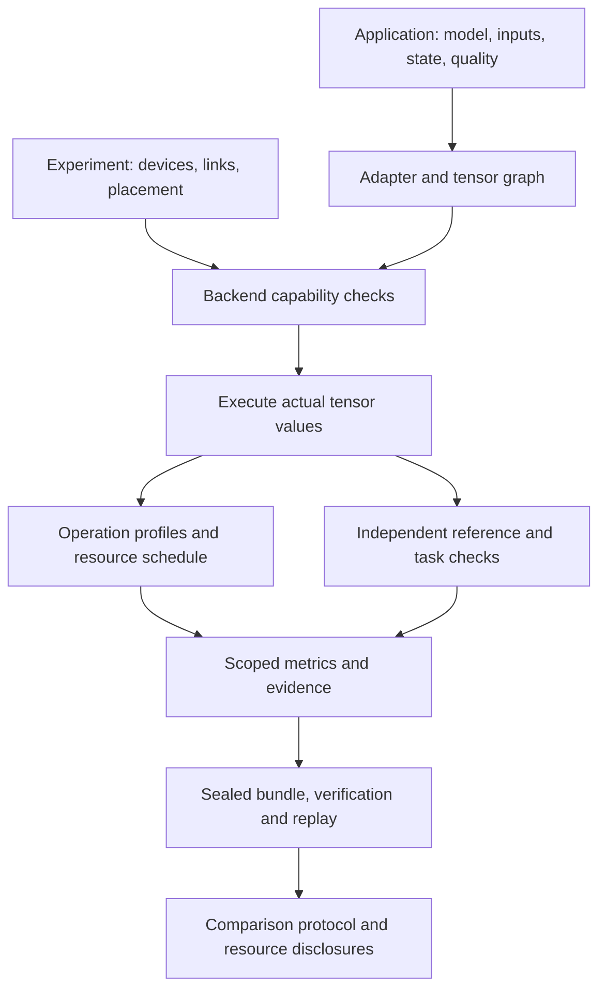

# Architecture

When a matrix multiplication runs on a selected backend, its returned array becomes the input to the next operation. The scheduler uses the operation's separately reported cost to place compute and transfer events. This separation lets a numerical failure, a scheduling assumption, and a timing-model error remain distinguishable.

## From an application to a result

An **application** fixes semantic assets, inputs, preprocessing, scenario, and quality policy. An **experiment** fixes a platform, mapping, and permitted implementation variant. Their identities are hashed separately so a platform change does not silently become a workload change. An **adapter** validates a particular application format and returns the common result contract.

The generic application adapters load `tensor-graph/v2` or a supported ONNX model, input arrays, and independent reference arrays. The GPT-2 adapter constructs a complete graph for each prefill/decode/evaluation call and passes each layer's KV arrays explicitly between calls. Paper adapters preserve their upstream executable's narrower semantics; a timing-only paper adapter does not gain tensor-level correctness merely by sharing the application interface.

## Numerical execution

The v2 graph declares every value's dtype and shape. Symbols bind dynamic dimensions. Every value has a single producer, and nodes appear in dependency order. Precision conversion is an operation with a visible input and output.

The default executor evaluates supported operations with NumPy. A checked callback may replace an operation and return both an array and backend metadata. The output still has to satisfy the declared shape, dtype, and finite-value contract. Native matrix lowerers create instructions and memory images; their instruction interpreters compute the tensor values. The external timing simulator contributes a separate timing observation.

The native SRAM path accepts INT8 operands and INT32 results. The native HBM path accepts FP16 operands/results with its documented sequential FP32 arithmetic. Native timing comes from external CIMFlow or a separately patched DCC runtime, respectively. These numerical and timing components have separate provenance. See [tensor semantics](tensor-runtime.md) and [platform contracts](tensor-platform.md).

The earlier `typed-graph/v1` retains its own scalar arithmetic contract. Versioned frontends must preserve the chosen contract; importing a model does not authorize changing its rounding or overflow behavior.

## Resource scheduling

An execution profile records each operation's dependencies, duration, placement, tensor sizes, and workspace. The scheduler reserves destination compute resources, directed transfer links, and both endpoints' DMA resources. Independent work can overlap when those resources and dependencies permit it.

Memory lifetimes include inputs, resident weight copies, intermediates, outputs, and packing workspace. Capacity is checked over concurrent request lifetimes. Cold requests load their own weights; warm scheduling shares byte-identical initializer copies per destination and includes the first upload. The implementation uses deterministic list scheduling and performs no eviction.

This produces a feasible schedule under the supplied model. It does not measure the time spent executing on physical accelerators. Reusing one operation profile for multiple identical requests creates predictions for that stream, not independent experimental repetitions.

## Evidence and comparison

An application bundle records assets, configuration, source snapshots, metrics, quality observations, and hashes. Verification checks the recorded file set and bytes. Replay executes the frozen implementation and compares the resulting observations. External native binaries remain separately supplied and identity-bound; preserving a bundle alone does not redistribute or recreate those binaries.

A comparison then checks task identity, status, quality, metric unit/scope/aggregation, platform and resource constraints, and the required evidence. Different architectures can be compared under an explicit budget or a disclosed whole-system configuration. Neither track makes an unequal resource comparison a causal demonstration of a scheduling technique.

Hashes prove consistency with recorded bytes. They cannot establish that a measurement was honestly obtained, that a cost model charges every claimed activity, or that an omitted failure never occurred. [Comparison](comparison.md) specifies admission and qualification; [limitations](limitations.md) describes the remaining boundaries.

## Where to extend

| Change | Main entry points | Required contract |
|---|---|---|
| New input format or task evaluation | `application.register_adapter`, adapter `prepare` / `inspect` / `execute` | Semantic assets, explicit state, quality evaluation, scoped metrics |
| New tensor operation | `tensor_ir`, `tensor_executor` | Shape, dtype, arithmetic, resource budget, independent numerical checks |
| New ONNX lowering | `tensor_onnx` | Source semantics preserved, unsupported attributes rejected, original-model reference comparison |
| New native matrix backend | `unified.register_backend`, shared platform integration | Accepted shapes/precision, actual outputs, workspace, cost origin, runtime identity |
| Other tensor backend operations | `tensor_executor` callbacks | Returned array contract and explicit integration into placement/cost accounting |
| New comparison or calibration study | `comparison` | Pinned inputs, disclosed resources, scope, repetitions, held-out calibration where applicable |

The backend registry is an explicit Python interface; arbitrary third-party backends are not automatically loaded from JSON. A new backend may need a corresponding tensor-platform lowering when its operations exceed the existing matrix interface.
